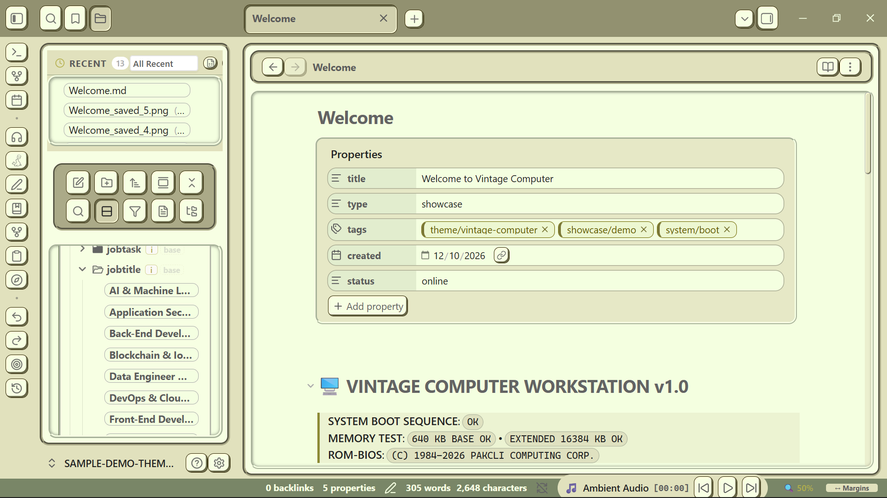

# 🖥️ Vintage Computer

A tactile, retro-computing inspired theme for [Obsidian](https://obsidian.md).

**Vintage Computer** brings back the soul of classic computing, retro workstations, and early graphical user interfaces into modern note-taking. Built with tactile window borders, CRT phosphor tones, mechanical-era typography, and an intelligent adaptive multi-row toolbar for fluid workspace productivity.

  

---

## ✨ Highlights

- 📺 **Classic Computing Aesthetic**: Tactile window frames, nostalgic UI controls, and authentic retro workstation vibes.
- 🎛️ **Adaptive Multi-Row Toolbar**: Editing toolbars dynamically wrap across multiple rows without clipping or awkward overflow.
- 🎨 **Dynamic OKLCH Color Engine**: Pick your primary accent, and the theme automatically computes harmonious vintage palettes.
- 👁️ **Distraction-Free Focus**: Clean workspace layout, vintage callouts, and retro-inspired typography.
- ⚙️ **Style Settings Ready**: Deeply configurable toggles for borders, shadows, scanlines, and buttons via the Style Settings plugin.

---

## 🚀 Installation

### Via Obsidian Community Themes (Recommended)
1. In Obsidian, open **Settings > Appearance > Themes**.
2. Click **Manage** and search for `Vintage Computer`.
3. Click **Install and use**.

### Via Obsidian Community Themes (Recommended)
1. In Obsidian, open **Settings > Appearance > Themes**.
2. Click **Manage** and search for `Vintage Computer`.
3. Click **Install and use**.

### Manual Installation
1. Download `manifest.json` and `theme.css` from the [Latest Release](https://github.com/pakcli/Vintage-Computer/releases/latest).
2. In your Obsidian vault, navigate to `.obsidian/themes/`.
3. Create a new folder named `Vintage Computer`.
4. Place `manifest.json` and `theme.css` inside that folder.
5. In Obsidian, go to **Settings > Appearance > Themes** and select **Vintage Computer**.

---

## 📄 Attribution & Acknowledgments

**Vintage Computer** is maintained by [pakcli](https://github.com/pakcli) and was originally forked from [Retroma](https://github.com/emarpiee/retroma) by [emarpiee](https://github.com/emarpiee).

Special thanks to the original creator **emarpiee** for the foundational architecture and styling system.

---

## 📜 License

This project is licensed under the [MIT License](LICENSE.txt).
